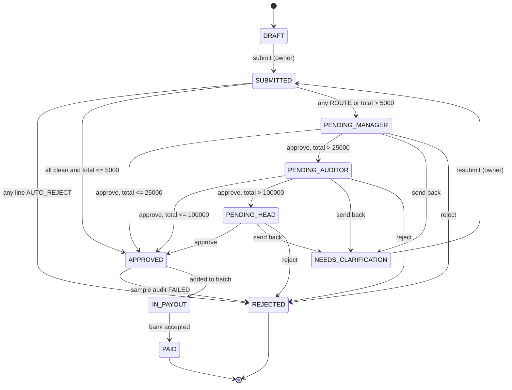
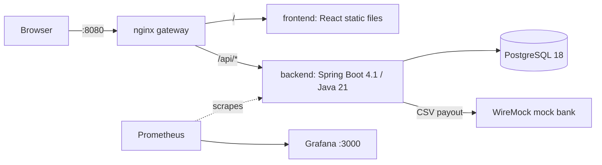

# ExpenseFlow – Expense Claims and Policy-Driven Approvals

**Team 45 · AI Manthan 2026 · Track A (Application Development)**
Dipesh Patidar (lead, backend) · Mohit Namdev (frontend) · Prasang Jhawar (DevOps, QA)

> **This README is the single source of truth for WHAT we build and the rules it follows.**
> Order of authority: **this README** (requirements, rules, statuses, data) → `docs/openapi.yaml` (exact API shapes, locked at T+35) → code.
> If code or the contract disagrees with this file, stop and raise it in team chat. Only Dipesh changes this file.

---

## 0. Quick start

```powershell
git clone <REPO_URL> team45; cd team45
powershell -ExecutionPolicy Bypass -File scripts/check.ps1     # tests + build + stack up + integration tests
```

| Open | URL |
|---|---|
| App (through the nginx gateway) | http://localhost:8080 |
| Swagger UI | http://localhost:8080/api/swagger-ui.html |
| Grafana (dashboard: Hackathon – Overview) | http://localhost:3000 |
| Prometheus / WireMock (dev file only) | http://localhost:9090 / http://localhost:8089 |

**Demo users** (password `Demo@123`, synthetic):

| Role | Email | Notes |
|---|---|---|
| EMPLOYEE | `emp.demo@expenseflow.test` | Main demo claimant, reports to `mgr.demo` |
| EMPLOYEE | `colleague.demo@expenseflow.test` | Owns a claim used for the "blocked" demo |
| MANAGER | `mgr.demo@expenseflow.test` | Manager of both demo employees |
| MANAGER | `mgr.leave@expenseflow.test` | On leave; delegated to `mgr.demo` for today ± 3 days |
| AUDITOR | `auditor.demo@expenseflow.test` | Review queue, bulk approve, sample audit |
| HEAD | `head.demo@expenseflow.test` | Approves > 1,00,000 INR, payout, dashboard, admin |

Reset demo data: `docker compose down -v` then start again (Flyway re-seeds).

---

## 1. Introduction

### 1.1 Problem
A mid-size services company reimburses expenses through email threads and Excel. Policy breaches slip through, duplicate receipts get paid, and managers take days to respond.

### 1.2 Product
ExpenseFlow is a web app where employees submit expense claims, a **policy engine** checks every line against configurable rules, claims move through a **multi-level approval chain** (manager → finance auditor → finance head), auditors work a **review queue** with bulk actions and sample audits, and approved claims are paid through a **payout batch** exported as a CSV bank file to a (mock) bank. A dashboard and an append-only audit trail make spend and decisions visible.

### 1.3 In scope (MUST)
Login and roles · claims with line items and receipts · drafts · idempotent submit · policy engine (6 rules, config-driven) · approval chain with thresholds · send back / reject / comment · delegation · auditor queue with filters and bulk approve · 10% sample audit · payout batch + CSV + mock bank + PAID · dashboard · audit trail · seeded data · metrics, alerts, runbook.

### 1.4 Out of scope
Editing policy rules in the UI (SKIP) · email/push notifications · receipt OCR · multi-currency (INR only) · real bank integration · SSO · mobile native app.
SHOULD (only if all MUST is green by T+125): read-only policy page, delegation form, re-download of past payout files.

### 1.5 Glossary
| Term | Meaning |
|---|---|
| Claim | One reimbursement request with 1..n line items |
| Line | One expense (category, amount, date, vendor, city, receipt) |
| Outcome | Policy result per line: `AUTO_APPROVE`, `ROUTE`, `AUTO_REJECT` |
| Flag | Reason a line needs attention: `OVER_LIMIT`, `MISSING_RECEIPT`, `DUPLICATE`, `WEEKEND`, `NO_POLICY` |
| Approval level | `MANAGER`, `AUDITOR`, `HEAD` |
| Delegation | Approver lets another user act for them between two dates |
| Sample audit | Random 10% of auto-approved claims sent to the auditor queue |
| Payout batch | Group of approved claims paid together via one bank CSV |
| Tier-1 city | Mumbai, Delhi, Bengaluru, Chennai, Kolkata, Hyderabad, Pune, Ahmedabad (config) |

---

## 2. Users, roles and permissions

Every user is an employee and can submit their own claims. The role adds approver/finance powers.

| Role | Goal |
|---|---|
| `EMPLOYEE` | Get reimbursed quickly: submit claims, answer clarifications |
| `MANAGER` | Approve team claims fast, send back unclear ones, delegate while on leave |
| `AUDITOR` | Review claims > 25,000 INR and sample audits; bulk approve |
| `HEAD` | Approve claims > 1,00,000 INR, run payouts, watch the dashboard; admin |

### 2.1 Permission matrix

| Action | EMPLOYEE | MANAGER | AUDITOR | HEAD |
|---|---|---|---|---|
| Create / edit / submit own claim | ✓ | ✓ | ✓ | ✓ |
| View a claim | own only | own + direct reports' + delegated | all | all |
| Approve / send back / reject at MANAGER level | – | direct reports (or as delegate) | – | – |
| Approve / send back / reject at AUDITOR level, bulk approve | – | – | ✓ | – |
| Clear / fail a sample audit | – | – | ✓ | – |
| Approve / send back / reject at HEAD level | – | – | – | ✓ |
| Create payout batch, download CSV, retry | – | – | – | ✓ |
| Dashboard | – | – | ✓ | ✓ |
| View policy rules | ✓ | ✓ | ✓ | ✓ |
| Create delegation | – | ✓ | ✓ | ✓ |

A claim the caller may not view returns **404** (not 403), so its existence is not revealed. A forbidden *action* on a visible claim returns **403**.

---

## 3. Golden demo flow (the one flow that must work perfectly)

1. **EMPLOYEE** (375 px window) creates a claim of ~30,500 INR: Hotel, Mumbai, 3 nights × 7,500 = 22,500 · Meals 1,200 · Local cab 800 (Saturday) · Flight 6,000, each with a receipt. Saves draft. Double-clicks **Submit** → still one claim.
2. **SYSTEM**: hotel `OVER_LIMIT` (R2), cab `WEEKEND` (R6), flight `NO_POLICY` → claim `PENDING_MANAGER`.
3. **MANAGER** opens the queue, sees receipts side by side with the flagged lines, approves. Total > 25,000 → `PENDING_AUDITOR` (R9).
4. **EMPLOYEE** opens the colleague's claim URL → 404 (R13). **MANAGER** tries to approve their own claim → 403 (R15).
5. **AUDITOR** filters the queue (flag = OVER_LIMIT), bulk-approves → `APPROVED`.
6. **HEAD** creates a payout batch. Mock bank is stopped → claims stay `IN_PAYOUT`, UI shows "Waiting for bank", Grafana alert fires. Bank started → retry job sends → `PAID` (R12).
7. **HEAD** opens the dashboard and the claim's audit timeline (R14).

---

## 4. Functional requirements

IDs: `FR-<area>-<n>`. Story IDs (`ST-xx`) match `docs/stories.yaml` and the Excel workbook.

### 4.1 Authentication and access (ST-01, ST-04)
- **FR-AUTH-1** `POST /api/auth/login` with email + password returns a JWT (HS256, 60 min) and the user profile (id, name, role, department).
- **FR-AUTH-2** Passwords stored with BCrypt. Login is rate-limited by the gateway (30/min/IP).
- **FR-AUTH-3** Every `/api/**` endpoint except login requires a valid token (else 401) and a role from the matrix (else 403).
- **FR-AUTH-4** Object-level checks on the server for every claim, line, receipt and audit read (R13). Unauthorised → 404.
- **FR-AUTH-5** The UI hides menu items and actions the role cannot use (defence in depth, not the control).

### 4.2 Claims, lines and receipts (ST-02, ST-03)
- **FR-CLM-1** Create a claim as `DRAFT` with a title and 1..20 lines.
- **FR-CLM-2** Line fields: `category` (enum below), `expenseDate` (not in the future, not older than 90 days), `amount` (> 0, ≤ 10,00,000, 2 decimals, INR), `vendor` (1–120 chars), `city` (required for HOTEL), `nights` (required for HOTEL, 1–30), `description` (optional, ≤ 500), `receiptId` (optional).
- **FR-CLM-3** Categories: `MEALS`, `HOTEL`, `LOCAL_CAB`, `FLIGHT`, `TRAIN`, `OTHER`.
- **FR-CLM-4** Claim total = sum of line amounts, computed on the server.
- **FR-CLM-5** A claim can be edited only in `DRAFT` or `NEEDS_CLARIFICATION`, only by its owner. Edits use optimistic locking (`version`); a stale version → 409.
- **FR-CLM-6** Receipt upload: `multipart/form-data`, JPEG/PNG/PDF only (415 otherwise), ≤ 5 MB (413 otherwise). Stored in the database with its SHA-256 hash. The response says if the same hash already exists (`duplicateOfReceiptId`).
- **FR-CLM-7** Submit requires header `Idempotency-Key` (UUID). Same key + same user → same response, no second submission (R-IDEM). Same key with a different body → 409.
- **FR-CLM-8** On submit the policy engine runs (4.3) and the claim moves to `REJECTED`, `APPROVED` or `PENDING_MANAGER`.
- **FR-CLM-9** "My claims" lists the caller's claims with status, total, submitted date; filter by status; paginated.

### 4.3 Policy engine (ST-03) – rules are configuration, never code (R7)

Rules live in `policy_rules`, settings in `app_settings`, tier-1 cities in `city_tiers`. The engine reads them at evaluation time (cache ≤ 60 s).

**Seeded configuration**

| Code | Category | Limit | Unit | Condition |
|---|---|---|---|---|
| `MEAL_DAILY` | MEALS | 1,500 | per employee per day | sum of the employee's MEALS lines for that date across all non-rejected claims |
| `HOTEL_T1` | HOTEL | 6,000 | per night | city is tier-1 (`amount / nights`) |
| `HOTEL_OTHER` | HOTEL | 4,000 | per night | city is not tier-1 |
| `CAB_TRIP` | LOCAL_CAB | 2,000 | per trip (line) | – |

| Setting | Value |
|---|---|
| `receipt.required.above` | 500 |
| `auto_approve.max_total` | 5,000 (assumption A1) |
| `approval.auditor.above` | 25,000 |
| `approval.head.above` | 1,00,000 |
| `sample_audit.rate` | 0.10 |
| `alert.oldest_pending.hours` | 48 |

**Algorithm per line** (all checks run, all flags collected):

| # | Check | Result |
|---|---|---|
| R4 | `amount > 500` and no receipt | flag `MISSING_RECEIPT`, outcome `AUTO_REJECT`, reason "Receipt required above 500 INR" |
| R1 | MEALS daily sum > 1,500 | flag `OVER_LIMIT`, outcome `ROUTE` |
| R2 | HOTEL `amount / nights` > tier limit | flag `OVER_LIMIT`, outcome `ROUTE` |
| R3 | LOCAL_CAB amount > 2,000 | flag `OVER_LIMIT`, outcome `ROUTE` |
| R5 | an earlier line of the **same employee** has the same vendor (case-insensitive, trimmed) + amount + date, **or** any earlier receipt (any employee) has the same SHA-256 | flag `DUPLICATE`, outcome `ROUTE` |
| R6 | `expenseDate` is Saturday or Sunday | flag `WEEKEND`, outcome `ROUTE` |
| – | category has no rule (FLIGHT, TRAIN, OTHER) | flag `NO_POLICY`, outcome `ROUTE` |
| – | none of the above | outcome `AUTO_APPROVE` |

Precedence per line: `AUTO_REJECT` > `ROUTE` > `AUTO_APPROVE`. Limits are inclusive: exactly 1,500 / 6,000 / 4,000 / 2,000 / 500 is within policy.

**Claim outcome (R8, R16):**
1. Any line `AUTO_REJECT` → claim `REJECTED` with all reasons.
2. Else any line `ROUTE`, or total > `auto_approve.max_total` → `PENDING_MANAGER` (or `PENDING_AUDITOR` if the claimant has no manager).
3. Else → `APPROVED` (auto). With probability `sample_audit.rate` set `sampleAudit = OPEN` (R11).

The engine stores each line's `outcome`, `flags` and `reason`, and records one audit event with the summary.

### 4.4 Approval chain (ST-05, ST-06, ST-08)
- **FR-APR-1** Levels in order: MANAGER (claimant's `manager_id`) → AUDITOR if total > 25,000 → HEAD if total > 1,00,000 (R9). Thresholds are strict ("above"): exactly 25,000 ends at manager.
- **FR-APR-2** Actions at the current level: **approve** (optional comment), **send back** (comment required) → `NEEDS_CLARIFICATION`, **reject** (reason required) → `REJECTED`.
- **FR-APR-3** After `NEEDS_CLARIFICATION` the employee edits and resubmits; the policy engine runs again and the chain restarts at MANAGER (R17).
- **FR-APR-4** Nobody acts on their own claim (R15) → 403. A manager's own claim goes to their manager. An auditor's own claim at AUDITOR level goes to another auditor.
- **FR-APR-5** Delegation (R10): `delegations(approver, delegate, from_date, to_date)`. The delegate may act for the approver at MANAGER level when today is within the dates. The approval step stores both `approver_id` (on behalf of) and `acted_by_id`. Expired or future delegation → 403.
- **FR-APR-6** Each decision writes an `approval_steps` row and an audit event in the same transaction as the status change.
- **FR-APR-7** Approver queue: MANAGER sees `PENDING_MANAGER` claims of direct reports and delegators; AUDITOR sees `PENDING_AUDITOR` + `APPROVED` with open sample audit; HEAD sees `PENDING_HEAD`. Sorted oldest first, paginated.
- **FR-APR-8** Comments: approvers and the claimant can add comments to a claim; shown in the timeline.

### 4.5 Auditor queue and sample audit (ST-07)
- **FR-AUD-1** Filters: department, category, flag, status, amount range, submitted date range, sample audit only.
- **FR-AUD-2** Bulk approve: `POST /api/approvals/bulk-approve` with `claimIds` (1..100) and `Idempotency-Key`. Each claim is processed independently; the response lists per-claim result (`APPROVED`, `PENDING_HEAD`, or error code). Claims not in `PENDING_AUDITOR` are skipped with `409`.
- **FR-AUD-3** Sample audit: auditor marks an open sample audit `CLEARED` (claim can be paid) or `FAILED` with a reason (claim → `REJECTED`).

### 4.6 Payout and mock bank (ST-09)
- **FR-PAY-1** Eligible claims: `APPROVED` and sample audit not `OPEN`.
- **FR-PAY-2** HEAD creates a batch from selected eligible claims (`Idempotency-Key`). In one transaction: batch row `PENDING_SEND`, claims → `IN_PAYOUT`, CSV generated and stored.
- **FR-PAY-3** The backend then sends the CSV to the bank (`EXTERNAL_SERVICE_URL`), timeout 3 s. Accepted → batch `SENT` with `bankReference`, claims `PAID`, `paid_at` set (R12).
- **FR-PAY-4** Bank down / timeout / 5xx → batch stays `PENDING_SEND`, `attempts++`, `lastError` saved, no 500 to the user. A scheduled job every 30 s resends all `PENDING_SEND` batches. HEAD can also press **Retry now**.
- **FR-PAY-5** HEAD can download the CSV of any batch.

**CSV bank file** (`PAYOUT_<batchRef>_<yyyyMMdd>.csv`, UTF-8, comma, header row, LF):

```csv
batch_ref,claim_number,employee_code,employee_name,account_number,ifsc,amount_inr,narration
PB-20261127-001,EXP-2026-000123,E0042,Asha Verma,123456789012,HDFC0001234,30500.00,EXP-2026-000123 reimbursement
```

**Mock bank API** (WireMock, `wiremock/mappings/`):

```
POST /bank/payouts
Content-Type: text/csv
X-Batch-Ref: PB-20261127-001
→ 202 {"bankReference":"BNK-8F3K2Q","status":"ACCEPTED","received":1}
```

### 4.7 Dashboard (ST-10)
`GET /api/dashboard/summary?from=YYYY-MM-DD&to=YYYY-MM-DD` (AUDITOR, HEAD), default last 12 months, based on `submitted_at`:
- KPI cards: pending approvals (count by level), oldest pending age (hours), policy violations (flagged lines), average approval time (submit → final approval, hours), total paid.
- Charts: spend by category, spend by department, spend by month (APPROVED + IN_PAYOUT + PAID), violations by flag.
- Exceptions table: 10 oldest pending claims with a link.

### 4.8 Audit trail (ST-11)
- **FR-AUDIT-1** Every state change, decision, comment, delegation, upload, login, payout send/attempt writes one `audit_events` row: actor, on-behalf-of, action, entity, from status, to status, details (JSON), correlation id, timestamp (R14).
- **FR-AUDIT-2** Append-only: a database trigger rejects `UPDATE` and `DELETE` on `audit_events`. No API updates or deletes audit rows.
- **FR-AUDIT-3** `GET /api/claims/{id}/audit` returns the claim's timeline (same visibility as the claim).

### 4.9 Business rules (canonical list)

| ID | Rule |
|---|---|
| R1 | Meals ≤ 1,500 INR per employee per day |
| R2 | Hotel ≤ 6,000 INR/night in tier-1 cities, ≤ 4,000 elsewhere |
| R3 | Local cab ≤ 2,000 INR per trip |
| R4 | Receipt mandatory above 500 INR; missing → AUTO_REJECT |
| R5 | Duplicate (same vendor + amount + date, or same receipt hash) → flag + ROUTE |
| R6 | Weekend spend → flag for manager |
| R7 | All limits and thresholds come from configuration tables |
| R8 | Policy returns AUTO_APPROVE / ROUTE / AUTO_REJECT per line; claim outcome per 4.3 |
| R9 | Chain: MANAGER → AUDITOR if total > 25,000 → HEAD if total > 1,00,000 |
| R10 | Delegate acts only within delegation dates; audit stores both people |
| R11 | 10% of auto-approved claims flagged for sample audit |
| R12 | Only eligible APPROVED claims go into a batch; PAID only when the bank accepts |
| R13 | An employee sees only their own claims (server-side, 404 otherwise) |
| R14 | Audit trail is append-only and covers every action |
| R15 | Nobody approves their own claim |
| R16 | Auto-approve only if every line is clean and total ≤ 5,000 INR |
| R17 | Resubmission re-runs the policy engine and restarts the chain |

---

## 5. Claim state machine



`SUBMITTED` is transient (same transaction as the policy run). All transitions go through one `StatusFlow` class with an explicit table; anything else → **409** with a clear message. Each transition writes an audit event in the same transaction.

| From | To | Who | Guard | API |
|---|---|---|---|---|
| DRAFT | SUBMITTED | owner | ≥ 1 line, valid | `POST /api/claims/{id}/submit` |
| SUBMITTED | REJECTED / APPROVED / PENDING_MANAGER / PENDING_AUDITOR | SYSTEM | policy outcome (4.3) | (same call) |
| PENDING_MANAGER | APPROVED / PENDING_AUDITOR | claimant's manager or active delegate | not own claim; threshold | `POST /api/claims/{id}/approve` |
| PENDING_AUDITOR | APPROVED / PENDING_HEAD | AUDITOR | not own claim; threshold | `.../approve`, `POST /api/approvals/bulk-approve` |
| PENDING_HEAD | APPROVED | HEAD | not own claim | `.../approve` |
| PENDING_* | NEEDS_CLARIFICATION | current approver | comment required | `POST /api/claims/{id}/send-back` |
| PENDING_* | REJECTED | current approver | reason required | `POST /api/claims/{id}/reject` |
| NEEDS_CLARIFICATION | SUBMITTED | owner | valid | `.../submit` |
| APPROVED | REJECTED | AUDITOR | sample audit OPEN → FAILED | `POST /api/claims/{id}/sample-audit` |
| APPROVED | IN_PAYOUT | HEAD | sample audit not OPEN | `POST /api/payout-batches` |
| IN_PAYOUT | PAID | SYSTEM | bank 2xx | (send / retry job) |

Payout batch statuses: `PENDING_SEND` → `SENT`.

---

## 6. Data model (PostgreSQL 18, Flyway)

Conventions: `snake_case`; `id BIGSERIAL` PK; money `NUMERIC(12,2)`; timestamps `TIMESTAMPTZ` (UTC, shown in IST); enums as `VARCHAR` + `CHECK`; `created_at` default `now()`.

| Table | Columns (key ones) | Constraints / indexes |
|---|---|---|
| `departments` | id, code, name | `code` UNIQUE |
| `employees` | id, employee_code, name, email, password_hash, role, department_id, manager_id, account_number, ifsc, active | `email` UNIQUE; role CHECK in (EMPLOYEE, MANAGER, AUDITOR, HEAD); FK department, FK manager → employees |
| `city_tiers` | city, tier | PK city |
| `policy_rules` | id, code, category, limit_amount, unit, city_tier, active, description | `code` UNIQUE |
| `app_settings` | key, value, description | PK key |
| `claims` | id, claim_number, employee_id, title, status, total_amount, sample_audit (NONE/OPEN/CLEARED/FAILED), submitted_at, final_decision_at, paid_at, payout_batch_id, version, created_at, updated_at | `claim_number` UNIQUE; status CHECK; idx (employee_id, status), (status, submitted_at) |
| `claim_lines` | id, claim_id, line_no, category, expense_date, amount, vendor, city, nights, description, receipt_id, outcome, flags `TEXT[]`, reason | FK claim (cascade on draft delete only); idx (expense_date, amount), lower(vendor) |
| `receipts` | id, owner_id, file_name, content_type, size_bytes, sha256, data `BYTEA`, uploaded_at | idx sha256 |
| `approval_steps` | id, claim_id, level, approver_id, acted_by_id, decision (APPROVED/SENT_BACK/REJECTED), comment, decided_at | idx claim_id |
| `claim_comments` | id, claim_id, author_id, body, created_at | idx claim_id |
| `delegations` | id, approver_id, delegate_id, from_date, to_date, created_at | CHECK from_date ≤ to_date, approver ≠ delegate |
| `payout_batches` | id, batch_ref, status, claim_count, total_amount, file_name, csv_content, attempts, last_error, bank_reference, created_by, created_at, sent_at | `batch_ref` UNIQUE |
| `audit_events` | id, actor_id, on_behalf_of_id, action, entity_type, entity_id, claim_id, from_status, to_status, details `JSONB`, correlation_id, created_at | trigger blocks UPDATE/DELETE; idx claim_id |
| `idempotency_keys` | id, idem_key, user_id, endpoint, request_hash, response_status, response_body `JSONB`, created_at | UNIQUE (idem_key, user_id) |

Migrations: `V1__schema.sql`, `V2__seed_config_and_users.sql`, `V3__seed_claims.sql`. Never edit an applied migration; add a new one.

---

## 7. API catalogue (detail lives in `docs/openapi.yaml`)

**Conventions**
- Base path `/api`, JSON, camelCase. Auth header `Authorization: Bearer <jwt>`.
- Lists: `?page=0&size=20` (max 100) → `{ "content": [...], "page", "size", "totalElements", "totalPages" }`.
- Create/submit/bulk/payout calls require `Idempotency-Key`.
- Errors: RFC 9457 ProblemDetail `{ type, title, status, detail, instance, correlationId, errors[] }`. 400 validation · 401 no/invalid token · 403 role or forbidden action · 404 not found or not visible · 409 invalid transition, stale version, idempotency conflict · 413/415 upload · 429 from gateway. No stack traces.
- Every response has `X-Request-ID` (gateway) used as correlation id.

| Method | Path | Roles | Story | Notes |
|---|---|---|---|---|
| POST | `/api/auth/login` | public | ST-01 | email, password → token, user |
| GET | `/api/me` | all | ST-01 | current user |
| GET | `/api/claims` | all | ST-04 | own claims; filter status |
| POST | `/api/claims` | all | ST-02 | create draft (Idempotency-Key) |
| GET | `/api/claims/{id}` | visible | ST-02 | claim + lines + flags + steps |
| PUT | `/api/claims/{id}` | owner | ST-02 | replace title + lines; `version` required |
| POST | `/api/claims/{id}/submit` | owner | ST-03 | Idempotency-Key; runs policy |
| POST | `/api/receipts` | all | ST-02 | multipart upload → id, sha256, duplicateOfReceiptId |
| GET | `/api/receipts/{id}/content` | visible | ST-05 | streams file (viewer) |
| GET | `/api/approvals/queue` | MANAGER, AUDITOR, HEAD | ST-05, ST-07, ST-08 | role-specific queue + filters |
| POST | `/api/claims/{id}/approve` | approver | ST-05, ST-08 | optional comment |
| POST | `/api/claims/{id}/send-back` | approver | ST-05 | comment required |
| POST | `/api/claims/{id}/reject` | approver | ST-05, ST-08 | reason required |
| POST | `/api/approvals/bulk-approve` | AUDITOR | ST-07 | claimIds; per-claim results |
| POST | `/api/claims/{id}/sample-audit` | AUDITOR | ST-07 | `{ result: CLEARED \| FAILED, reason }` |
| GET / POST | `/api/claims/{id}/comments` | visible | ST-05 | list / add |
| GET | `/api/claims/{id}/audit` | visible | ST-11 | timeline |
| GET / POST | `/api/delegations` | MANAGER, AUDITOR, HEAD | ST-06 | mine / create |
| GET | `/api/payout/eligible` | HEAD | ST-09 | eligible claims |
| POST | `/api/payout-batches` | HEAD | ST-09 | claimIds; creates + sends |
| GET | `/api/payout-batches` | HEAD | ST-09 | list with status |
| GET | `/api/payout-batches/{id}` | HEAD | ST-09 | detail |
| GET | `/api/payout-batches/{id}/file` | HEAD | ST-09 | CSV download |
| POST | `/api/payout-batches/{id}/retry` | HEAD | ST-09 | resend now |
| GET | `/api/dashboard/summary` | AUDITOR, HEAD | ST-10 | KPIs + series |
| GET | `/api/policy-rules` | all | – | read-only config (SHOULD page) |

---

## 8. Frontend specification

Stack: React 19 + Vite + TypeScript (strict), shadcn/ui + Tailwind, TanStack Query, react-hook-form + zod, Recharts, lucide. **Look and feel: `read-design-claude.md`** (components, colours, status badges, flag chips, states, 375 px).

| Route | Roles | Screen | Key content |
|---|---|---|---|
| `/login` | public | Login | email, password, errors, 429 message |
| `/claims` | all | My claims | table/cards with status badge, total, date; filter; "New claim" |
| `/claims/new`, `/claims/:id/edit` | owner | Claim capture (mobile-first) | line cards, category-specific fields (city/nights for HOTEL), receipt upload with camera, running total, Save draft, Submit (disabled while pending) |
| `/claims/:id` | visible | Claim detail | lines with outcome + flag chips, receipts, comments, audit timeline, status |
| `/approvals` | MANAGER, AUDITOR, HEAD | Approval queue | dense table, filters (AUDITOR: department, category, flag, amount, sample audit), checkboxes + sticky bulk-approve bar (AUDITOR) |
| `/approvals/:id` | approver | Approver view | receipt viewer left, lines + flags right (stacked on mobile), Approve / Send back / Reject with comment, timeline |
| `/payouts` | HEAD | Payouts | eligible claims, Create batch, batch list with status (`Waiting for bank` / `Sent`), Retry now, Download CSV |
| `/dashboard` | AUDITOR, HEAD | Dashboard | KPI cards, 3 charts, violations, exceptions table |
| `/policy` | all | Policy (SHOULD) | read-only rules and settings |

Rules: all API calls in `src/api/` with relative `/api/...` URLs; 401 → login; 429 → "slow down" toast; every data view has loading, empty, error (with correlation id + retry) and success states; `data-testid` on every button and input used in tests; client-side validation mirrors section 4.2 but the server is the authority. Dev: Prism on 4010 until T+80, then the gateway on 8080.

---

## 9. Non-functional requirements

### 9.1 Security
| ID | Requirement |
|---|---|
| NFR-SEC-1 | BCrypt passwords; JWT HS256 with a ≥ 32-byte secret from `JWT_SECRET`; 60 min expiry |
| NFR-SEC-2 | `@PreAuthorize` on every endpoint + object-level checks in services (R13, R15) |
| NFR-SEC-3 | Bean Validation on every request body and param; DB constraints as last line |
| NFR-SEC-4 | Uploads: type and size checked, stored in DB, served with the stored content type and `Content-Disposition` |
| NFR-SEC-5 | No secrets in Git (`.env`, `secrets/` ignored); DB password via Docker secret |
| NFR-SEC-6 | Gateway: only public port, rate limits, security headers, `/actuator` not routed; no CORS needed |
| NFR-SEC-7 | Bank account numbers masked (last 4) in UI lists and logs; synthetic data only |
| NFR-SEC-8 | CI dependency check (Trivy fs + image scan) blocks HIGH/CRITICAL fixable issues |
| NFR-SEC-9 | Security checklist run with Claude (incl. "ways to bypass approvals"); real findings fixed, false alarms recorded |

### 9.2 Performance
- p95 < 500 ms for claim list, claim detail, queue and submit at 50 virtual users against the backend (k6, measured, reported honestly).
- Dashboard summary < 1 s on 3,000 claims.
- Indexes per section 6. No N+1 queries on lists (fetch joins or projections).

### 9.3 Reliability and consistency
- Every state change + audit event in one `@Transactional` service call.
- Optimistic locking on `claims.version`; idempotency table for submit/create/bulk/payout.
- Bank failures never lose a payout: batch stays `PENDING_SEND`, retried every 30 s.
- Backend health: `/actuator/health` includes DB and a `bank` health indicator.

### 9.4 Observability (SRE)

| Metric (Micrometer → Prometheus) | Type | Purpose |
|---|---|---|
| `expenseflow_pending_claims{level}` | gauge | queue size per level |
| `expenseflow_oldest_pending_seconds{level}` | gauge | approval age |
| `expenseflow_policy_outcomes_total{outcome}` | counter | auto-approve / route / reject mix |
| `expenseflow_claim_transitions_total{from,to}` | counter | business flow |
| `expenseflow_payout_pending_batches` | gauge | stuck payouts |
| `expenseflow_bank_call_seconds{outcome}` | timer | bank latency and failures |
| `expenseflow_idempotent_replays_total` | counter | duplicate submits caught |
| `http_server_requests_seconds` | histogram | page/API latency p95/p99 |

| Alert (Prometheus rule) | Condition |
|---|---|
| `OldestPendingApprovalTooOld` | `max(expenseflow_oldest_pending_seconds) > 48h` for 5m |
| `BankPayoutFailing` | `expenseflow_payout_pending_batches > 0` for 1m |
| `HighErrorRate` | 5xx > 5% of requests for 1m |
| `HighLatencyP95` | p95 > 1 s for 2m |

Grafana dashboard rows: traffic & errors · latency p95 · approvals (queue size, oldest pending) · policy outcomes · payout & bank. Logs: JSON to stdout with correlation id.

### 9.5 Usability and accessibility
Mobile-first claim capture at 375 px; labels on every input, visible focus, keyboard-usable dialogs, AA contrast, `aria-live` toasts. Approver flow timed with a stopwatch (target: decision in < 30 s per claim).

---

## 10. Architecture and deployment



One backend service (modular packages: `auth`, `claims`, `policy`, `approval`, `payout`, `dashboard`, `audit`). No queues, no microservices. Built on the starter template (hardened containers, private networks, gateway).

| Env var | Default (laptop) | Purpose |
|---|---|---|
| `SPRING_DATASOURCE_URL` | `jdbc:postgresql://localhost:5432/app` | DB |
| `SPRING_DATASOURCE_USERNAME` | `app` | DB user |
| `db_password` (Docker secret) | `app` | DB password |
| `JWT_SECRET` | dev-only value | token signing |
| `JWT_TTL_MINUTES` | 60 | token life |
| `EXTERNAL_SERVICE_URL` | `http://localhost:8089` | mock bank (`http://wiremock:8080` in Docker) |
| `BANK_TIMEOUT_MS` | 3000 | bank call timeout |
| `PAYOUT_RETRY_INTERVAL_MS` | 30000 | retry job interval |
| `GRAFANA_ADMIN_PASSWORD` | change-me | Grafana admin |

Compose files: `docker-compose.yml` (gateway, frontend, backend, postgres, wiremock) · `docker-compose.monitoring.yml` (prometheus, grafana, nginx-exporter, k6) · `docker-compose.dev.yml` (opens 5432, 8089, 9090 for local runs).
CI (`.github/workflows/ci-cd.yml`): lint → build + unit/integration tests → Trivy scan → stack up + `tests/integration.sh` → k6 smoke.

---

## 11. Seed data (synthetic only)

| Item | Volume | Detail |
|---|---|---|
| Departments | 8 | Engineering, Sales, Marketing, Finance, HR, Operations, Customer Success, Legal |
| Employees | 150 | 1 HEAD, 3 AUDITOR, 16 MANAGER (2 per department), 130 EMPLOYEE; reporting hierarchy; demo users from section 0 |
| Policy config | – | `policy_rules`, `app_settings`, `city_tiers` per 4.3 |
| Historical claims | 3,000 | last 12 months, all statuses (mostly PAID), 1–5 lines each, realistic INR amounts |
| Planted issues | – | ~5% duplicate lines (same vendor+amount+date), ~2% reused receipt hashes, ~8% limit breaches, ~10% weekend lines |
| Current queue | ~40 | claims in PENDING_* submitted in the last 24 h, plus **one stuck claim 3 days old** so `OldestPendingApprovalTooOld` shows firing |
| Delegation | 1 | `mgr.leave` → `mgr.demo`, today ± 3 days |
| Audit events | – | one `SEEDED` event per historical claim |

---

## 12. Testing strategy

| Level | What | Tool | Owner |
|---|---|---|---|
| Unit (written **before** the engine) | every policy rule incl. boundaries: 1,500 vs 1,500.01; hotel 6,000 vs 6,000.01 (tier-1) and 4,000 vs 4,000.01; cab 2,000 vs 2,000.01; receipt 500 vs 500.01; duplicate by fields and by hash; weekend; NO_POLICY; claim outcome aggregation; auto-approve 5,000 vs 5,000.01 | JUnit 5 parameterised | Prasang |
| Unit | StatusFlow: every valid transition and invalid ones (→ 409); thresholds 25,000 / 25,000.01 / 1,00,000 / 1,00,000.01 | JUnit 5 | Prasang |
| Integration | idempotent submit (1 row, same response); concurrent edits (409); rollback on error; 401/403/404/400; delegation in/out of dates; self-approval 403; audit row per action and UPDATE blocked; payout with bank down then up | MockMvc + Postgres (Compose or Testcontainers) | Prasang |
| E2E (10 cases, 5 automated) | see list below | Playwright (TS), HTML report, 375 px project | Mohit |
| Performance | golden-path mix 70% read / 30% write; backend run (numbers) + gateway run (429s) | k6 | Prasang |
| Security | checklist + Claude review; Trivy | Claude, Trivy | Dipesh, Prasang |
| Gateway | headers, actuator hidden, SPA fallback, rate limit | `tests/integration.sh` | Prasang |

**E2E cases:** E2E-01 login per role + correct menu · E2E-02 create draft with receipts, reopen, edit · E2E-03 double-click submit → one claim · E2E-04 missing receipt above 500 → auto-rejected with reason · E2E-05 over-limit hotel routed, manager approves ≤ 25,000 → APPROVED · E2E-06 claim > 25,000 → manager → auditor bulk approve · E2E-07 send back → employee edits → resubmit → routed again · E2E-08 delegate approves for manager on leave · E2E-09 employee opens colleague's claim → not found; manager approves own → blocked · E2E-10 head payout with bank down → waiting → bank up → PAID.
Automate first: 03, 05, 06, 09, 10.

---

## 13. Repository and ownership

```
team45/
  README.md                 this file (SRS, single source of truth) – Dipesh
  CLAUDE.md                 rules for Claude sessions – Dipesh
  read-design-claude.md     design system – Mohit
  docker-compose*.yml, gateway/, monitoring/, wiremock/, loadtest/, secrets/, scripts/, tests/, .github/ – Prasang
  backend/                  Spring Boot (src/main – Dipesh; src/test + db/migration – Prasang)
  frontend/                 React (Mohit)
  docs/                     openapi.yaml, stories.yaml, architecture.md, adr/, test-plan.md, runbook.md, ai-log/ – Dipesh (+ owners)
  evidence/                 test reports, k6 summaries, screenshots – all
```

Branches `dipesh/<slice>`, `mohit/<slice>`, `prasang/<slice>`; merge to `main` when `scripts/check.ps1` is green. Commit format: `feat(backend): approve claim [ST-05]`. Never force-push `main`.

---

## 14. Traceability

| Story | Functional reqs | Rules | Main APIs | Tests |
|---|---|---|---|---|
| ST-01 Login & roles | FR-AUTH-1..5 | R13 | `/auth/login`, `/me` | E2E-01, 401/403 tests |
| ST-02 Draft claim | FR-CLM-1..6 | R4, R5 | `/claims`, `/receipts` | E2E-02 |
| ST-03 Submit + policy | FR-CLM-7..8, 4.3 | R1–R8, R11, R16 | `/claims/{id}/submit` | rule unit tests, E2E-03, E2E-04 |
| ST-04 Own claims only | FR-AUTH-4, FR-CLM-9 | R13 | `/claims` | E2E-09 |
| ST-05 Manager decisions | FR-APR-1..4, 6..8 | R9, R15, R17 | approve / send-back / reject | E2E-05, E2E-07, E2E-09 |
| ST-06 Delegation | FR-APR-5 | R10, R14 | `/delegations` | E2E-08 |
| ST-07 Auditor queue | FR-AUD-1..3 | R9, R11 | `/approvals/queue`, bulk-approve, sample-audit | E2E-06 |
| ST-08 Head approval | FR-APR-1..2 | R9 | approve / reject | threshold tests |
| ST-09 Payout | FR-PAY-1..5 | R12 | `/payout-batches` | E2E-10, bank-down integration test |
| ST-10 Dashboard | 4.7 | R1–R6 | `/dashboard/summary` | dashboard API test |
| ST-11 Audit trail | FR-AUDIT-1..3 | R14 | `/claims/{id}/audit` | audit tests |
| ST-12 Monitoring | 9.4 | – | `/actuator/prometheus` | failure drill evidence |

---

## 15. Assumptions and open questions

| # | Assumption (confirm with organisers) | Impact if wrong |
|---|---|---|
| A1 | Clean claims auto-approve only up to 5,000 INR total | change `auto_approve.max_total` |
| A2 | Over-limit lines and duplicates are routed with a flag, not auto-rejected | change outcome in the rule table |
| A3 | Missing receipt above 500 INR auto-rejects the claim | change to ROUTE |
| A4 | Thresholds apply to the claim total, strictly "above" | change comparisons |
| A5 | Approvers can reject (brief names comment, send back, delegate) | remove reject action |
| A6 | Meal limit is per employee per day across all claims | per-claim sum instead |
| A7 | PAID only when the mock bank accepts the file | set PAID on CSV export |
| A8 | Sample-audited claims are held from payout until cleared | allow payout |
| A9 | Duplicate by fields is checked within the same employee; by receipt hash across everyone | widen/narrow query |
| A10 | Resubmission restarts the chain at MANAGER | keep previous approvals |
| A11 | HEAD's own claims stop at AUDITOR level (no second head to approve) | needs another approver |
| A12 | Receipts stored in PostgreSQL (containers are read-only) | object storage volume |

---

## 16. Definition of done and deliverables

**A slice is done when:** it matches this README and `openapi.yaml`; tests for its rules exist and pass; `scripts/check.ps1` is green; states, roles and audit rows are correct; one commit with the story ID.

**Gates:** T+35 contract locked · T+80 login + step 1 through the UI on Compose · T+125 golden path end to end · T+140 feature freeze · T+170 code freeze · T+185 clean clone works · T+215 two timed rehearsals.

**10 submission artifacts:** presentation · codebase + README · test plan · test results · UI designs · stories in Excel · application demo · ideation document · low-level design · runbook. Plus `docs/ai-log/` with key Claude prompts per phase.